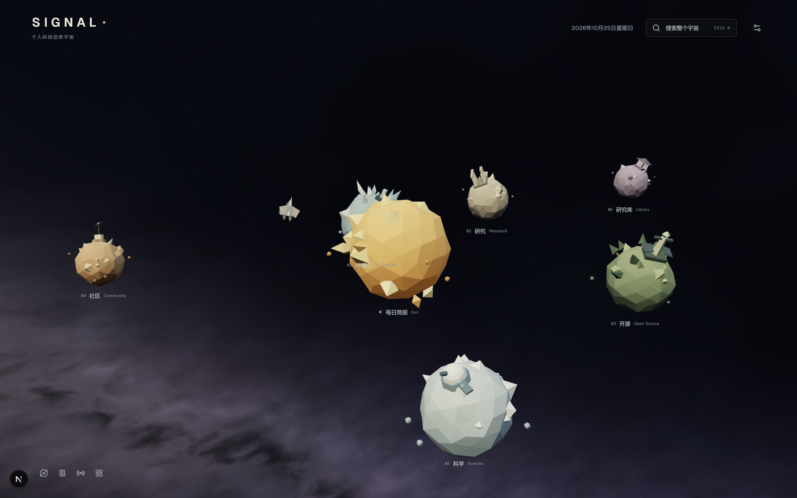
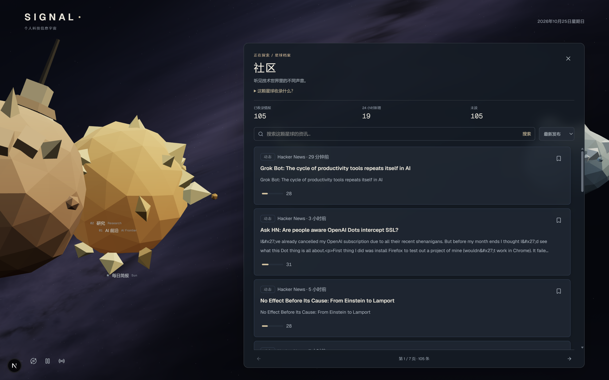

# SIGNAL Universe

**把 AI 与前沿科技资讯，变成可以探索的个人信息宇宙。**

SIGNAL 是面向个人使用的科技情报与研究工作台，将 arXiv、GitHub、Hacker News 和 RSS/Atom 的内容汇集到同一个空间。你可以从三维太阳系进入不同领域，阅读每日简报、追踪开源项目，再将值得保留的内容整理进自己的研究库。

## 界面预览

### 宇宙全景

太阳是每日简报入口，六颗星球对应不同的资讯领域与个人研究库。原创低多边形天体、随视角变化的程序化银河，以及自动绕星飞行的小飞船，共同构成首页。



### 星球内阅读

点击星球后，镜头飞向它的真实轨道；抵达后在同一场景中展开阅读面板，可以继续浏览资讯和查看详情。



## 现在可以做什么

### 在太阳系里探索资讯

- **三维导航**：星球持续公转与自转，外侧星球公转更慢；支持拖动视角、缩放和键盘选择。
- **场景内阅读**：镜头跟随选中星球的公转，阅读时保留宇宙背景；返回全景后可切换其他板块。
- **自动跟随飞船**：初始围绕 AI 前沿飞行，选择其他天体后自动飞往并环绕目标。
- **真实更新信号**：根据本地数据展示内容总量、24 小时新增与更新时间，可关闭更新提示。
- **适配不同浏览方式**：支持移动端、暂停动画、系统“减少动态效果”偏好和普通导航；WebGL 不可用时仍可访问内容。

| 入口 | 内容 |
|---|---|
| 太阳 · 每日简报 | 今天值得关注的资讯、核心变化与阅读重点 |
| AI 前沿 | AI 模型、智能体、编程工具与基础设施 |
| 研究 | AI 研究、数学、计算机科学与论文方法 |
| 开源 | GitHub 仓库、开发工具与项目趋势 |
| 社区 | Hacker News 与已接入 RSS 的技术讨论和早期信号 |
| 科学 | 具身智能、机器人与其他前沿科学进展 |
| 研究库 | 收藏、稍后阅读、笔记、研究合集与后续追踪 |

社区目前接入 Hacker News 和 RSS，尚未接入 X 数据源。每日简报、探索、深度研究、主题、趋势和研究库也保留独立页面入口。

### 用简报筛选重点，按需调用模型

每日简报从最近 24 小时的资讯中筛选内容，支持手动更新、未读筛选、批量标记已读和历史简报回看。

重要性评分由规则计算，综合个人关注权重、技术变化与时效、潜在影响、证据可核查性、学习与复用价值，并可查看分项依据。评分用于阅读排序，不代表真实性或独立验证结论。

配置模型后，系统只为**入选简报且尚无有效模型分析**的条目生成摘要与解读，包括关键变化、证据、为什么重要、局限与个人相关性；已有分析会复用，避免对全库逐篇调用模型。未配置模型密钥时，内置规则引擎仍可完成基础分析与评分。

### 把阅读积累成个人研究库

- **收藏与稍后阅读**：统一管理阅读队列、已读状态和笔记。
- **研究合集**：收藏时选择合集，也可以直接创建新合集。
- **后续进展**：基于仓库标识、模型系列与 arXiv 论文编号，匹配本地已采集内容中的新进展。
- **持续回顾**：支持主题订阅、关键词、每周回顾与相关内容建议。
- **Markdown 导出**：导出选中条目或当前筛选结果，保留摘要、关键变化、来源链接和研究笔记。

### 汇集多源信息，保留原始出处

支持 arXiv 每日公告 RSS 与 API、GitHub REST API、Hacker News，以及自定义 RSS/Atom 订阅源；提供全局搜索、领域筛选、排序、分页与同事件聚合。

GitHub 趋势页面用于发现值得关注的仓库与项目动向。采集支持手动触发和可选的定时任务，也可按来源暂停，保留历史记录。列表与简报使用实际采集数据，原文链接始终可访问。

## 工作方式

1. **采集**：从已启用的数据源获取内容并存入本地 SQLite。
2. **筛选**：使用规则评分和个人关注权重，选出每日简报内容。
3. **解读**：为入选且缺少有效模型分析的条目按需调用模型，其他内容保留规则分析。
4. **沉淀**：通过收藏、笔记、合集、进展提醒与导出，持续积累研究资料。

当前版本的模型解读融入简报与阅读流程，不再提供独立分析页面或全库模型分析操作。

## 本地运行

需要 Node.js ≥ 22.5 和 npm，数据库使用 Node.js 内置的 `node:sqlite`。

```bash
npm install
```

复制 `.env.example` 为 `.env.local`。Windows PowerShell 可执行：

```powershell
Copy-Item .env.example .env.local
```

然后启动：

```bash
npm run dev
```

打开 [http://localhost:2026](http://localhost:2026)。数据库会在首次访问数据接口时自动初始化，默认保存在 `.data/signal.db`。首次使用需要采集资讯，可通过每日简报的手动更新操作触发。

### 常用命令

| 命令 | 用途 |
|---|---|
| `npm run dev` | 启动开发服务，端口 2026 |
| `npm run build` | 创建生产构建 |
| `npm run start` | 启动生产服务，端口 2026，需先构建 |
| `npm run lint` | ESLint 检查 |
| `npm run typecheck` | TypeScript 类型检查 |
| `npm test` | 单元测试 |
| `npm run test:e2e` | 浏览器回归测试；需先构建并安装 Chrome |

Windows 启动脚本位于 `scripts/launch.ps1`；如已配置桌面 `SIGNAL.bat`，可双击启动。脚本会检查已有服务、预热数据接口并打开浏览器，启动日志写入 `%TEMP%\signal-launch.log`。

## 配置

所有环境变量均为可选项。arXiv、GitHub 等来源可在无密钥时工作，受各自服务限额约束；自定义 RSS 需要填写订阅地址，模型解读需要填写相应 API 配置。

| 环境变量 | 作用 |
|---|---|
| `GITHUB_TOKEN` | 提升 GitHub API 请求限额，可在设置页验证认证 |
| `RSS_FEEDS` | 自定义 RSS/Atom 地址，多个地址用逗号分隔 |
| `ARXIV_RSS_CATEGORIES` | arXiv 订阅分类，默认 `cs.AI,cs.LG,cs.RO,cs.CL,cs.SE` |
| `SIGNAL_DISABLED_PROVIDERS` | 暂停指定来源，如 `arxiv,github`，保留历史数据 |
| `LLM_ANALYZER_API_KEY` | 启用模型解读 |
| `LLM_ANALYZER_BASE_URL` | OpenAI 兼容接口地址，支持 DeepSeek 等服务 |
| `LLM_ANALYZER_MODEL` | 使用的模型名称 |
| `LLM_ANALYZER_TIMEOUT_MS` | 单次模型请求超时，默认 90000 毫秒 |
| `SIGNAL_SCHEDULER_ENABLED` | 是否启用进程内定时任务，默认 `false` |
| `SIGNAL_SCHEDULER_INTERVAL_MS` | 定时任务间隔，默认 6 小时 |
| `SIGNAL_MIN_REQUEST_INTERVAL_MS` | 出站请求最小间隔；arXiv 至少为 3000 毫秒 |
| `SIGNAL_ADMIN_TOKEN` | 为手动更新及管理接口配置访问令牌 |
| `SIGNAL_DB_PATH` | 自定义 SQLite 数据库路径 |

关注领域权重保存在服务端并参与评分；每日简报条数、默认排序等其他偏好保存在当前浏览器。项目目前没有账号系统，界面采用统一深色风格。

完整配置示例见 [.env.example](.env.example)，部署与运维说明见[运行手册](docs/RUNBOOK.md)，阅读与评分细节见[研究工作流](docs/RESEARCH-WORKFLOW.md)，三维场景的演进记录见[宇宙实施记录](docs/UNIVERSE-AUDIT.md)。历史文档中的旧页面和截图记录以当前代码及本 README 为准。

## 技术栈

| 部分 | 技术 |
|---|---|
| 应用框架 | Next.js 16、React 19、TypeScript |
| 三维场景 | Three.js、程序化低多边形模型与银河背景 |
| 界面样式 | Tailwind CSS v4、CSS 变量、Lucide 图标 |
| 数据存储 | SQLite，使用 Node.js 内置 `node:sqlite` |
| 内容解读 | 规则引擎 + 可选的 OpenAI 兼容模型接口 |
| 质量检查 | Vitest、Playwright、ESLint、TypeScript |

## 数据与隐私

项目面向个人本地部署。采集内容、简报与研究库保存在本地数据库中；阅读状态及部分偏好保存在浏览器中。启用模型解读后，入选条目的内容会发送至所配置的模型服务。API 密钥仅由服务端读取，请勿提交 `.env.local` 或真实密钥。

外部内容和模型解读应结合原文判断。若向非受信任网络开放服务，需要配置适当的访问控制。

## 许可证

项目代码采用 [MIT 许可证](LICENSE)。第三方依赖、外部内容与商标遵循各自的许可条款。
