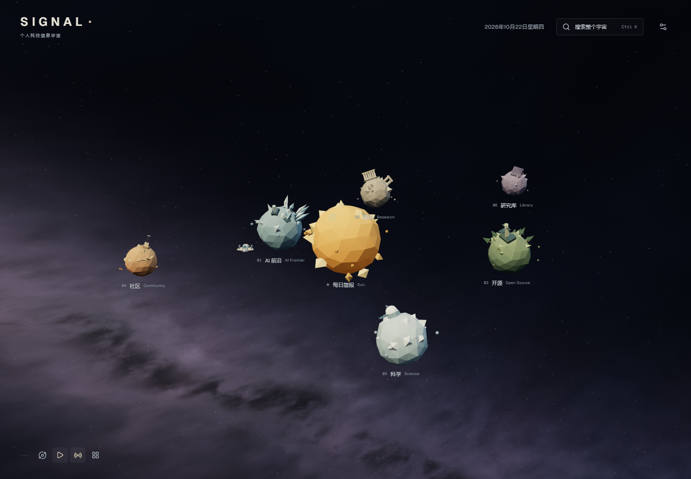
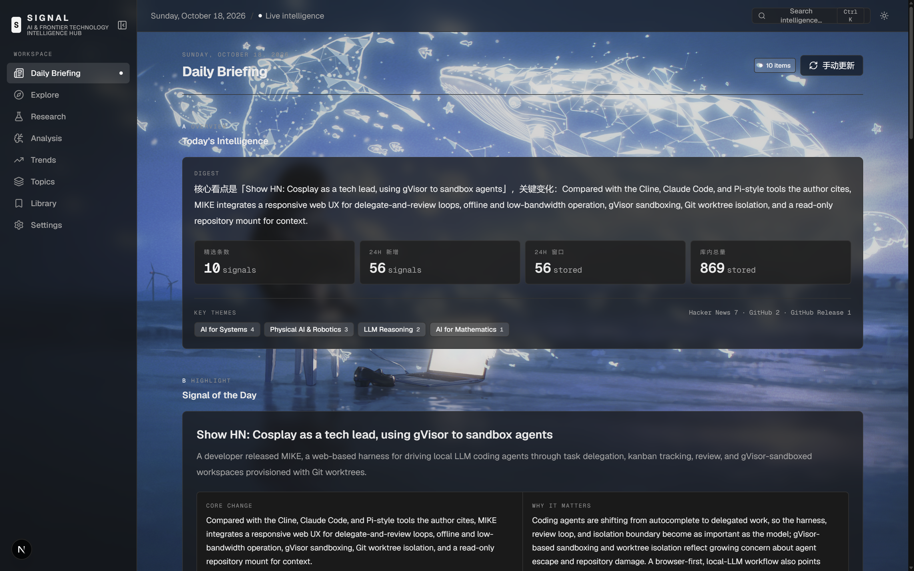

# SIGNAL Universe

### An Information Universe

首页为原创低多边形太阳系：太阳是每日简报入口，六颗公转并自转的星球分别对应 AI 前沿、研究、开源、社区、科学和研究库。公转速度随轨道半径增大而降低。背景为三维空间中的程序化银河、暗尘带和分层星点，随视角旋转、缩放产生自然变化。点击后镜头飞向星球真实轨道，在同一场景内阅读；所选星球在左侧露出右半球，太阳居于可见背景中央，镜头随公转追踪。返回全景才能切换板块；支持暂停、键盘、减少动态效果和无 WebGL 普通导航。独立分析页面、接口与全库分析任务已删除，简报摘要和重要性评分所需的共用计算保留。



全景中的低多边形飞船已放大为原来的两倍，体长约为社区星球直径的三分之二。初始绕 AI 前沿飞行，选择星球后自动飞往该星球并绕行；返回全景时继续围绕上次选择的星球。飞船不再提供控制入口、手动驾驶或模式切换。场景暂停和减少动态效果也会暂停飞船。

实现、路由映射、清理与验证记录见 [UNIVERSE-AUDIT.md](docs/UNIVERSE-AUDIT.md)。

**Discover what matters. Understand what changes. Track what comes next.**

SIGNAL is a personal intelligence workbench for tracking AI breakthroughs, model releases, research papers, and emerging technology trends.

It goes beyond headlines to help you understand **what changed, why it matters, and what is worth exploring next.**

中文简介：SIGNAL 是一个个人 AI 与前沿科技情报工作台，聚焦 AI 模型、数学与计算机科学、具身智能、科研突破，以及 GitHub 上的新兴技术趋势。
## ✦ Screenshots



---

## ✦ Focus Areas

| Domain | What to Track |
|---|---|
| **AI Models** | New releases, capability shifts, reasoning, multimodal AI |
| **AI × Science** | Mathematics, theorem proving, algorithms, scientific discovery |
| **Physical AI** | Robotics, VLA, world models, robot learning |
| **Agents & Coding** | AI agents, coding tools, inference and infrastructure |
| **Open Source** | Emerging repositories, developer tools, project momentum |
| **Frontier Science** | Selected breakthroughs in physics, biology, energy and beyond |

## ✦ Features

| Feature | Status |
|---|---|
| Daily intelligence briefing | Available; manual refresh from the page |
| AI-powered article analysis | Available; DeepSeek-compatible LLM with rule-based fallback |
| Briefing-scoped analysis | Available; only selected items that lack an analysis are sent to the model |
| Personal library, notes & collections | Available |
| Topic subscriptions & weekly review | Available |
| GitHub trend tracking | Available |
| Scheduled ingestion & analysis | Available |
| Search and research exploration | Available |

All primary pages — Daily Briefing, Explore, Research, Topics, Trends, and
Library — render real records collected from the connected sources. No sample or
placeholder content is served in production.

### Preferences

| Preference | Effect |
|---|---|
| Focus-area weights | Stored server-side (`focus_weights`) and used by the importance calculation |
| Daily signal count | Passed to `/api/briefing?count=` and caps the number of briefing items |
| Default sorting | Used as the initial Explore sort order until you change it in the view |
| Theme | Unified dark interface |

Preferences other than focus-area weights live in `localStorage` because SIGNAL has no
account system yet.

## ✦ How It Works

SIGNAL collects, analyzes, and organizes technology intelligence into a searchable personal knowledge base.

1. **Collect** — Retrieve articles and research from arXiv RSS/API, GitHub, RSS feeds, and Hacker News.
2. **Select** — Build today's briefing from the 24h window. Importance is a deterministic
   score (focus weights + novelty + impact + verifiability + learning), so selection needs
   no model call and never waits on one.
3. **Analyze** — Only the items that made the briefing are sent to the LLM, and only when
   they do not already have a real analysis; anything with an existing analysis is skipped.
   A refresh therefore costs at most *daily signal count* model calls, not one per new
   article. Selected items get an LLM-written one-line summary, key change, evidence,
   **why it matters, limitations and personal relevance**, while scoring stays deterministic.
   Without `LLM_ANALYZER_API_KEY` the rule-based engine keeps the pipeline working. An
   analysis that comes back missing those fields is never stored, so the interface cannot
   show a placeholder as if it were analysis.
4. **Track** — Save discoveries, organize research, and review developments over time.

Every stored article gets a free deterministic baseline analysis on ingest, so Explore,
Research and Topics stay complete while the paid analysis is reserved for the briefing.
The standalone Analysis page and full-archive analysis action have been removed.

Original sources remain accessible. Official claims, preprints, peer-reviewed research, and independent verification are treated as distinct forms of evidence.

## ✦ Tech Stack

- **Framework:** Next.js 16, React 19, TypeScript
- **Styling:** Tailwind CSS v4, CSS variables, Lucide
- **Database:** SQLite via Node.js `node:sqlite`
- **Data sources:** arXiv daily RSS, arXiv export API, GitHub REST API, Hacker News, RSS/Atom
  (arXiv and GitHub collection can be paused per source)
- **Analysis:** Rule-based engine with optional OpenAI-compatible LLM integration
  (verified against the DeepSeek API; each article is one chat completion)
- **Testing:** Vitest, ESLint, TypeScript, Next.js build

## ✦ Getting Started

### Requirements

- Node.js ≥ 22.5
- npm

### Installation

```bash
npm install
cp .env.example .env.local
npm run dev
```

Open the URL printed in your terminal. The port is set in `package.json`
(`"dev": "next dev -p 2026"`), so this checkout serves `http://localhost:2026`.

The SQLite database is initialized automatically on first access.

### Desktop launcher (Windows)

`SIGNAL.bat` on the desktop is a thin wrapper around `scripts/launch.ps1`. It:

1. finds the project (the folder next to the `.bat` that owns `scripts/launch.ps1`);
2. reads the port from `package.json`;
3. opens the browser immediately if the site already answers, otherwise starts
   `npm run dev` in a minimised console and waits for it;
4. warms the data routes (`/api/signals/stats`, `/api/briefing`, …) before opening
   the browser, because Next compiles each route on first request and an
   unwarmed page would sit on zeroed counters;
5. allows only one launcher at a time, so an impatient double-click cannot spawn
   two dev servers.

Every run appends to `%TEMP%\signal-launch.log`; if the launch fails the console
window prints that log and waits for a key press. Closing the minimised
"dev server" console stops the server.

### Available Commands

```bash
npm run dev        # Development server
npm run build      # Production build
npm run start      # Production server
npm run lint       # Lint checks
npm run typecheck  # TypeScript checks
npm test           # Unit tests
npm run test:e2e   # Browser tests; run build first, requires installed Chrome
```

## ✦ Configuration

All environment variables are optional. arXiv and GitHub can work without API keys, subject to service rate limits.

Sources can be paused individually with `SIGNAL_DISABLED_PROVIDERS`. A paused source
makes no outbound request, keeps its historical rows, and is reported as "paused" in
Settings and Trends.

| Variable | Purpose |
|---|---|
| `GITHUB_TOKEN` | Higher GitHub API rate limits (60 → 5000/h); verify it via Settings → GitHub 认证 |
| `LLM_ANALYZER_API_KEY` | Enable LLM-based analysis (why it matters, limitations, personal relevance) |
| `LLM_ANALYZER_BASE_URL` | OpenAI-compatible API endpoint |
| `LLM_ANALYZER_MODEL` | Analysis model |
| `LLM_ANALYZER_TIMEOUT_MS` | Per-request timeout, default 90000 |
| `RSS_FEEDS` | Additional RSS/Atom feeds |
| `ARXIV_RSS_CATEGORIES` | arXiv daily announcement categories to follow |
| `SIGNAL_DISABLED_PROVIDERS` | Pause automatic collection per source (e.g. `arxiv,github`) |
| `SIGNAL_MIN_REQUEST_INTERVAL_MS` | Outbound request pacing (arXiv stays ≥3000) |
| `SIGNAL_SCHEDULER_ENABLED` | Enable scheduled processing |
| `SIGNAL_ADMIN_TOKEN` | Protect manual/admin endpoints |
| `SIGNAL_DB_PATH` | Custom SQLite database path |

See `.env.example` and [`docs/RUNBOOK.md`](./docs/RUNBOOK.md) for additional configuration and operational details.

## ✦ Roadmap

- [x] Validate DeepSeek-powered analysis end to end (why it matters, limitations, personal relevance)
- [x] Select the briefing before analyzing; analyze only selected items that lack one
- [ ] Improve model-version and capability comparisons
- [ ] Build reliable multi-day trend measurements
- [ ] Add researcher/community signal tracking beyond arXiv
- [ ] Introduce browser-based end-to-end tests

## ✦ Security & Privacy

- Designed for single-user, local deployment.
- Never commit API keys or private environment files.
- External content and model outputs are treated as untrusted input.
- AI-generated analysis should be verified against original sources.

Do not expose the application to untrusted networks without appropriate access controls.

## ✦ License

Released under the [MIT License](./LICENSE).

This license applies to SIGNAL's own code, not third-party dependencies, external content, or trademarks.